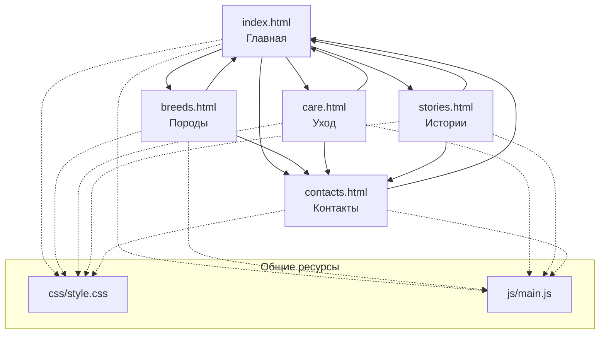

# 🐕 Крутые собаки — лендинг

Одностраничный лендинг о собаках: почему они крутые, обзор пород, цитата и призыв к действию.  
Сделан на чистом **HTML + CSS + JavaScript**, без сборки и зависимостей. Достаточно открыть `index.html` в браузере.

---

## 📌 Содержание
диаграмма

- [Демо](#-демо)
- [Что внутри](#-что-внутри)
- [Структура проекта](#-структура-проекта)
- [Быстрый старт](#-быстрый-старт)
- [Настройка](#-настройка)
- [Технологии](#-технологии)
- [Доступность](#-доступность)
- [Лицензия](#-лицензия)
```
---

## 🚀 Демо

Откройте `index.html` двойным кликом — сайт работает локально без сервера.  
Для публикации подойдёт **GitHub Pages**, **Netlify**, **Vercel** или любой статический хостинг.

---

## 🧩 Что внутри

- **Sticky-навигация** с логотипом, ссылками и CTA-кнопкой
- **Hero-блок** с заголовком, описанием, кнопками и статистикой
- **Секция «Почему собаки»** — 6 карточек с иконками и короткими фактами
- **Секция «Породы»** — 4 карточки с фото и подписями
- **Цитата** в стилизованном блоке
- **CTA-секция** с призывом завести собаку
- **Футер** с годом и ссылками
- **Адаптивность** под мобильные, планшеты и десктоп
- **Плавные анимации** появления карточек при скролле (IntersectionObserver)
- **Мобильное меню-бургер** для узких экранов.
